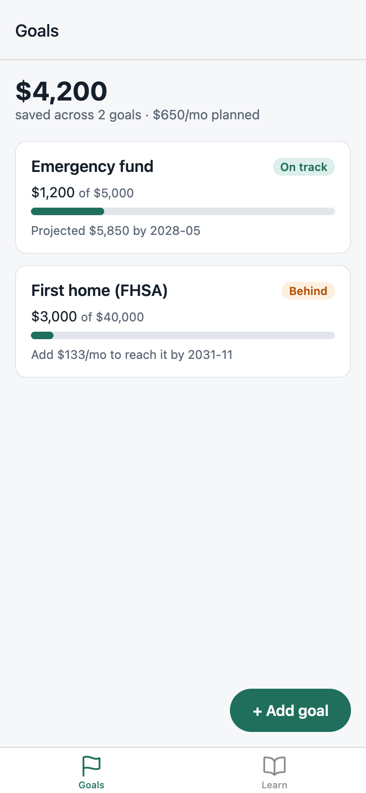
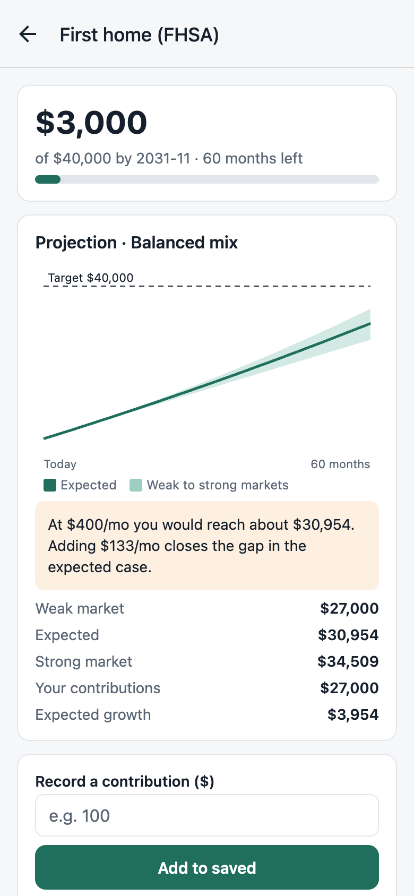
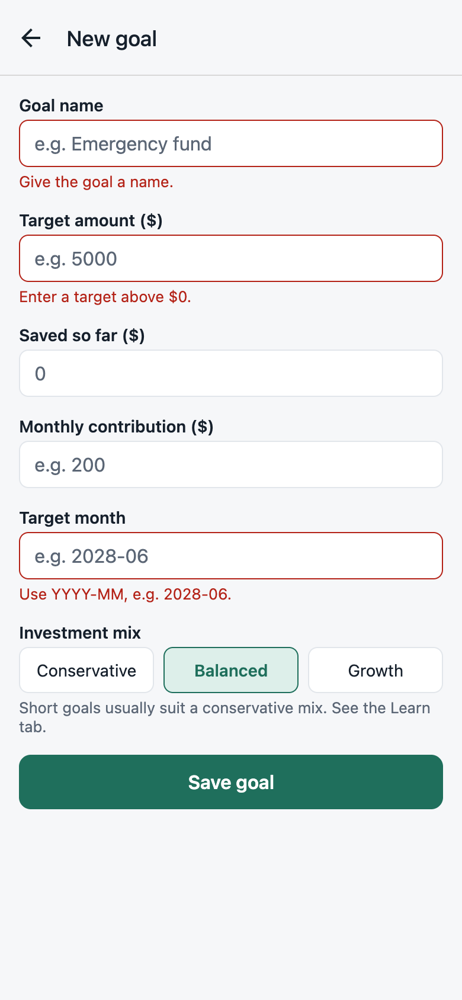
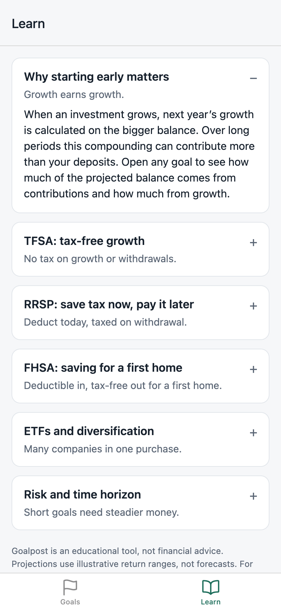

# Goalpost

A small React Native app that helps students and young investors set savings goals, see whether they are on track, and learn the basics of Canadian investing accounts. It runs on Android, iOS, and the web from one TypeScript codebase (Expo SDK 58, Expo Router).

<p>
  
  
  
  
</p>

## What it does

- **Goals**: name, target amount, amount saved, monthly contribution, target month, and an investment mix (conservative / balanced / growth). Each goal shows a progress bar and an **On track** or **Behind** badge.
- **Projection**: a chart from today to the target month with a shaded range from a weak to a strong market, the expected path, and the target line. If the goal is behind, the app says how much more per month closes the gap, and it splits the expected balance into your contributions and growth.
- **Record contributions**, delete goals, and keep everything on the device between launches.
- **Learn**: short cards on compounding, TFSA, RRSP, FHSA, ETFs, and risk vs. time horizon.
- **Try two sample goals** on the empty screen for a quick demo.

Goalpost is an educational tool, not financial advice. Return ranges are illustrative, not forecasts.

## Run it on an Android phone

1. Install **Expo Go** from the Google Play Store.
2. On your computer:
   ```bash
   npm install
   npx expo start
   ```
3. Scan the QR code in the terminal with Expo Go. Phone and computer need to be on the same Wi-Fi; if they are not, use `npx expo start --tunnel`.

Also: `npx expo start --web` for the browser, `npm test` for the tests, `npm run typecheck`.

## How it is built

| Area | Choice | Where |
|---|---|---|
| Navigation | Expo Router: a tab layout (Goals, Learn) inside a stack with a modal "New goal" screen and a `goal/[id]` detail route | `src/app/` |
| State | `useReducer` in a context provider; every change is saved to AsyncStorage, but never before the first load finishes, so a slow load cannot wipe saved goals | `src/state/GoalsContext.tsx` |
| Finance math | Pure functions with no React imports, so they are easy to test | `src/lib/finance.ts` |
| Validation | One function turns raw form text into a goal or a set of field errors; accepts `$` and commas | `src/lib/goals.ts` |
| Chart | Hand-drawn with `react-native-svg` (range band, expected line, dashed target); measures its own width | `src/components/ProjectionChart.tsx` |
| Accessibility | Roles and labels on buttons, the progress bar, the radio group, and the chart | components and screens |

### The math

Returns compound monthly at `r = (1 + annual)^(1/12) − 1`, with deposits at the end of each month:

- Future value: `FV = P(1 + r)^n + PMT · ((1 + r)^n − 1) / r`
- Monthly amount needed: `PMT = (target − P(1 + r)^n) · r / ((1 + r)^n − 1)`, or 0 if savings already grow past the target
- At 0% return both fall back to simple sums, so there is no division by zero.

| Mix | Weak | Expected | Strong (annual) |
|---|---|---|---|
| Conservative | 1% | 3% | 5% |
| Balanced | 0% | 5% | 9% |
| Growth | −2% | 6.5% | 13% |

## Tests and CI

22 Jest tests (`jest-expo` + React Native Testing Library):

- **Finance**: 0% edge cases, a lump sum compounding to exactly the annual rate, `requiredMonthly` inverting `futureValue`, low ≤ expected ≤ high on every month.
- **Goals**: validation of every field, the reducer (add / contribute / remove, saved never below 0), sample goals.
- **GoalCard**: on-track and behind states render the right message; pressing opens the goal.

GitHub Actions runs type checks, ESLint, the tests, and an Android + web bundle on every push and pull request.

### End-to-end on an Android emulator (Maestro)

`.maestro/` holds 4 Maestro flows that drive the real app the way a user would:

| Flow | What it checks |
|---|---|
| `01-create-goal` | Fill in the form, save, see the goal and portfolio summary on the list, open it, record a $100 contribution and see the balance go from $500 to $600 |
| `02-validation` | Saving an empty form shows each field's message; a past month is refused; nothing is saved |
| `03-persistence-and-delete` | Sample goals survive killing and relaunching the app; delete asks first, Cancel keeps the goal, Delete removes it, and the removal survives a relaunch too |
| `04-learn` | Lessons on the Learn tab expand to show their content |

The **Android E2E** workflow builds a release APK (`expo prebuild` + Gradle), boots an Android 13 emulator
in GitHub Actions, installs the APK, and runs every flow; the JUnit report and failure screenshots are kept
as a build artifact. Two things it took to make this reliable on CI: a short subflow that dismisses the
system "isn't responding" dialog a slow emulator sometimes shows, and centring each scrolled-to button so
taps never land on the navigation bar.

To run the flows locally, install [Maestro](https://maestro.mobile.dev), start an emulator or plug in a phone
with USB debugging, install a build, then `maestro test .maestro`. iOS is not covered yet.

## Next steps

- Edit a goal, and keep a contribution history per goal.
- Sync to a small backend so goals follow the user across devices.
- Run the Maestro flows on iOS too (needs a macOS runner).
